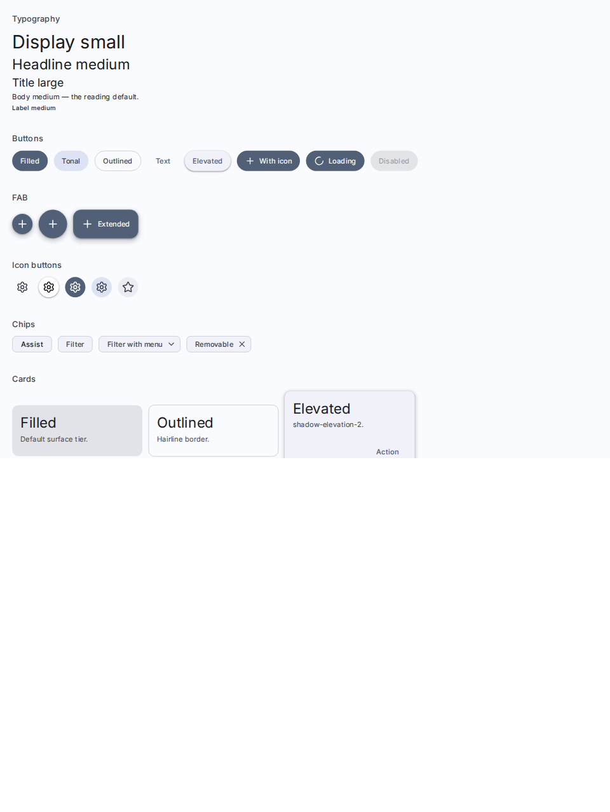
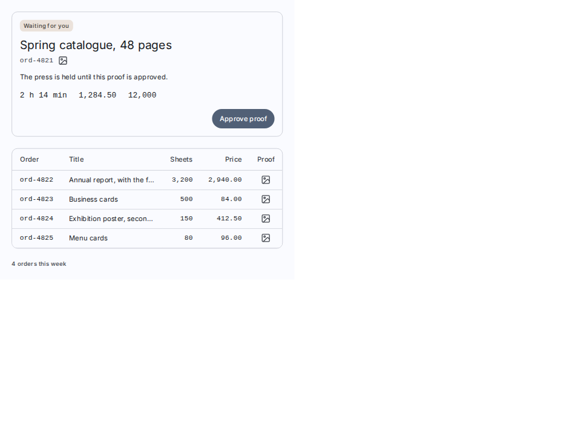

<div align="center">
  <h1>MD3 kit</h1>
  <h3><em>Material Design 3 components for React, copied into your project and themed from one <code>DESIGN.md</code>.</em></h3>
</div>

<p align="center">
  <a href="https://github.com/french-tech-homies/design-system/actions/workflows/checks.yml"></a>
  <a href="LICENSE"></a>
  
  
  <a href="https://french-tech-homies.github.io/design-system/"></a>
  <a href="#status"></a>
</p>

The components Material 3's specification describes, built on
[React Aria Components](https://react-aria.adobe.com) for behaviour and
accessibility and on Tailwind CSS 4 for style. shadcn's CLI copies them into
your project from the kit's registry, so they are files in your tree, not a
package. Their look comes from one `DESIGN.md`: the kit's generator turns it
into both colour schemes, the type scale and the corners, and no update ever
writes over it.

<p align="center">
  <picture>
    <source media="(prefers-color-scheme: dark)" srcset="screenshots/material/md3-overview--everything.dark.png">
    
  </picture>
  <picture>
    <source media="(prefers-color-scheme: dark)" srcset="screenshots/material/md3-composed-page--waiting.dark.png">
    
  </picture>
</p>

<p align="center"><sub>Two of the catalog's own screenshots, light or dark as your browser is.</sub></p>

## Quick start

In a React app with Tailwind CSS 4 and an `@/*` path alias (`create-next-app`
ships both; on Vite, see [Installing](docs/installing.md#install-from-the-registry)
first). Declare the registry in `package.json`:

```jsonc
// package.json
{ "registries": { "@ds": "https://french-tech-homies.github.io/design-system/r/{name}.json" } }
```

Then initialise and install:

```bash
npx shadcn@latest init @ds/base     # aria-nova style, lucide icons, theme files and utils
npx shadcn add @ds/ds               # the one install: everything, under <ui>/ds/ and .claude/skills/
```

After `init`, `add` asks whether to install a new style: answer yes (seen
with shadcn 4.23.0, on 2026-11-03).

The install writes nothing into your entry CSS. Import the theme there
(here `src/index.css`, beside `src/components/ui`):

```css
@import "tailwindcss";
@import "./components/ui/ds/tokens/theme.css";
@import "./components/ui/ds/tokens/bridge-shadcn.css"; /* only beside stock shadcn components */
@import "./components/ui/ds/tokens/theme.v4.css";
@import "tw-animate-css";
```

Use a component:

```tsx
import { Button, Card, CardContent } from "@/components/ui/ds";

<Card variant="elevated" elevation="medium">
  <CardContent
    headline="Table 12"
    supportingText="Two orders in progress"
    actions={<Button variant="tonal">Open</Button>}
  />
</Card>;
```

It draws in the kit's neutral default. **For a look of your own**, give the
project its own `DESIGN.md` (start from the kit's, which the install brought),
change what you want in it (its `seed`, a font), and generate:

```bash
cp src/components/ui/ds/DESIGN.md DESIGN.md
npx tsx src/components/ui/ds/tokens/generate-theme.mjs DESIGN.md --out theme
```

Then point the two theme imports at `theme/` instead:
`@import "../theme/theme.css";` and `@import "../theme/theme.v4.css";`.

Or open your coding agent in the project and ask for a look ("make it look
like cyberpunk"): the `ds-theme` skill the install brought does those steps,
and reads the generator's warnings. The install never writes the project's
`DESIGN.md` or its `theme/` folder, so no update puts the kit's default back
over them.

## Why this kit

- **A copy you own, at a price said.** The files land in your tree, where
  editing one is allowed, rarely needed, and priced: an update overwrites
  every kit file that differs, and you put your edit back by hand. No npm
  package, no runtime dependency on the kit, and no build output to keep in
  sync with your bundler.
- **Material 3, read from its spec.** Each component cites its page of
  m3.material.io in its doc comment, and is reviewed against Material's
  pages. The `ds-spec` skill reads the live spec, its Do's and Don'ts and its
  tokens.
- **React Aria's behaviour and accessibility.** Every component takes its
  accessible behaviour from React Aria Components, and a fresh Vite app that
  built a whole application shell from the kit has no Radix in its
  dependency tree.
- **The theme from one `DESIGN.md`**, in [Google Labs'
  format](https://github.com/google-labs-code/design.md). The generator turns
  it into both colour schemes, the type scale and the corners; components
  name roles (`bg-primary`, `text-on-surface`), never values.
- **Skills for coding agents.** `ds-theme`, `ds-build` and `ds-spec` land in
  your project's `.claude/skills/`: theming from a brief, the rules for
  building with the kit, and Material's spec.
- **Every story is a test.** Each story of the catalog is rendered in
  Chromium, played and checked by axe, under the Material theme and under a
  deliberately un-Material preset, and compared to its committed screenshots.

## Install

The quick start above is the recommended route. What a project needs:

- **React 19**, **Tailwind CSS 4.1 or later** (Tailwind 3 is not supported)
  and the `@/*` alias before `shadcn init`; on a Vite app, add both first.
- **shadcn's CLI 4.0.0 or later** for an update: `--dry-run` and `--diff`
  came with it. `npx shadcn` fetches one when your project has none.
- What `add` installs for you: `react-aria-components`, `tailwind-variants`,
  `clsx`, `tailwind-merge`, `tw-animate-css`, `react-phone-number-input` for
  `PhoneField`, and the generator's four dev dependencies. The kit ships no
  icon library: any component taking `{ size, className }` drops in.
- The router adapters are asked for by name, or `Button href` does full page
  loads: `npx shadcn add @ds/next-adapter` or `@ds/react-router-adapter`.

[Installing](docs/installing.md) has the rest: the Vite setup, what the one
install brings, seven things an install asks of a project (a monorepo, your
Tailwind scan, your linter), coming from `@md3`, and installing by copying
the folder instead.

## Update

From a clean working tree (commit first), in the folder that holds
`components.json`:

```bash
jq .version src/components/ui/ds/RELEASE.json        # the release you hold
curl -s https://french-tech-homies.github.io/design-system/r/button.json | jq .meta   # the one published

npx shadcn add @ds/ds --dry-run          # what the release would change, file by file; writes nothing
npx shadcn add @ds/ds --diff <path>      # the change itself, in one file the dry run marked ~ overwrite
npx shadcn add @ds/ds --overwrite -y     # take it
git diff                                 # read what moved
```

Read `CHANGELOG.md` from your release to the published one before you take
it: an entry that needs action from you is flagged.

**An adapter or the preset you added is named on the same three lines**,
or it stays at the old release:

```bash
npx shadcn add @ds/ds @ds/react-router-adapter --dry-run
npx shadcn add @ds/ds @ds/react-router-adapter --diff <path>
npx shadcn add @ds/ds @ds/react-router-adapter --overwrite -y
```

**A project that generates its own theme** (a `DESIGN.md` and a `theme/`
folder of its own) runs the generator again, and reads the diff of `theme/`.
It moves only when the release's CHANGELOG entry says the generator, its
template (`tokens/theme.v4.css`) or a default moved:

```bash
npx tsx src/components/ui/ds/tokens/generate-theme.mjs DESIGN.md --out theme
```

**A project that edited a kit file** runs one more command before the dry
run, `node src/components/ui/ds/changed.mjs`. The dry run and the diff
compare your copy with the incoming release, so a file you edited reads
`~ overwrite` exactly as a file the kit changed does, and the overwrite
removes your edit. `changed.mjs` compares your copy with the release you
installed (`RELEASE.json`), so it names your edits alone: after the
overwrite, put those back from `git diff`. A project that never edits a kit
file never needs it.

The rest, and why it works this way, is in
[Versioning and updates](docs/updating.md).

## Components

Each links to its page of the [catalog](https://french-tech-homies.github.io/design-system/),
where every variant is drawn, in light and dark.

| Category | Components |
| --- | --- |
| Foundations | [Colour][color], [typography][typography] (`Display`, `Headline`, `Title`, `Body`, `Label`), [shape and elevation][shape], [motion][motion], [interaction states][states] (`StateLayer`), [focus ring][focus] |
| Actions | [`Button`][button], [FAB][fab] (`Button variant="fab"`), [`FabMenu`][fabmenu], [`IconButton`][iconbutton], [`ButtonGroup`][buttongroup], [`SegmentedButton`][segmented], [`SplitButton`][split] |
| Communication | [`Badge`][badge], [`Divider`][divider], [`LoadingIndicator`][loading], [`ProgressIndicator`][progress], [`Snackbar`][snackbar], [`Tooltip`][tooltip] |
| Containment | [`BottomSheet`][bottomsheet], [`Card`][card], [`Carousel`][carousel], [`Dialog`][dialog] and `ModalDialog`, [`DialogContent`][dialogcontent], [`GridList`][list], [`ListItem`][listitem], [`Modal`][modal], [`SideSheet`][sidesheet], [`Tabs`][tabs] |
| Navigation | [`BottomNavigation`][bottomnav], [`Menu`][menu], [`MenuItem`][menuitem], [`NavigationDrawer`][drawer], [`NavigationRail`][rail], [`Search`][search], [`Toolbar`][toolbar], [`TopAppBar`][topappbar] |
| Selection | [`Checkbox`][checkbox], [`Chip`][chip], [`DatePicker`][datepicker] and `DateRangePicker`, [`Radio`][radio], [`Select`][select], [`Slider`][slider], [`Switch`][switch], [`TimePicker`][timepicker] |
| Text inputs | [`TextField`][textfield], [`ComboBox`][combobox], and the [react-hook-form adapter][form] |

### The kit's own

Eleven the kit ships that Material 3 does not describe, each built on
Material's foundations and saying so in its doc comment. How one joins the
group is in [What this kit is](docs/what-this-kit-is.md).

<!-- own-components -->

- [`Table`][table]: rows and columns of data. Material 3 publishes no data table.
- [`Tag`][tag]: a small label pill that sits in a line of text.
- [`Avatar`][avatar]: a person's picture or initials.
- [`Disclosure`][disclosure]: a heading that opens and closes a panel, alone or in a group.
- [`PreviewTrigger`][preview]: a card of any content opened by hovering or focusing its
  trigger.
- [`NumberField`][numberfield]: a text field for a number, with steppers.
- [`PhoneField`][phonefield]: a text field for a phone number, with a country picker.
- [`ImageField`][imagefield]: choosing, previewing and removing one image.
- [`EmptyState`][emptystate]: what a list or a page shows when it has nothing to show.
- [`Meter`][meter]: a quantity within a known range, such as a quota or a disk's use.
- [`ColorPicker`][colorpicker]: editing a colour, with its four parts `ColorArea`,
  `ColorField`, `ColorSlider` and `ColorSwatch`.

<!-- /own-components -->

[color]: https://french-tech-homies.github.io/design-system/?path=/story/md3-foundations-color--roles
[typography]: https://french-tech-homies.github.io/design-system/?path=/story/md3-foundations-typography--scale
[shape]: https://french-tech-homies.github.io/design-system/?path=/story/md3-foundations-shape-elevation--shape
[motion]: https://french-tech-homies.github.io/design-system/?path=/story/md3-foundations-motion--durations
[states]: https://french-tech-homies.github.io/design-system/?path=/story/md3-foundations-interaction-states--states
[focus]: https://french-tech-homies.github.io/design-system/?path=/story/md3-foundations-focus-ring--on-background
[button]: https://french-tech-homies.github.io/design-system/?path=/story/md3-actions-button--filled
[fab]: https://french-tech-homies.github.io/design-system/?path=/story/md3-actions-fab--small
[fabmenu]: https://french-tech-homies.github.io/design-system/?path=/story/md3-actions-fabmenu--closed
[iconbutton]: https://french-tech-homies.github.io/design-system/?path=/story/md3-actions-icon-button--default
[buttongroup]: https://french-tech-homies.github.io/design-system/?path=/story/md3-actions-buttongroup--standard
[segmented]: https://french-tech-homies.github.io/design-system/?path=/story/md3-actions-segmentedbutton--single-select
[split]: https://french-tech-homies.github.io/design-system/?path=/story/md3-actions-splitbutton--variants
[badge]: https://french-tech-homies.github.io/design-system/?path=/story/md3-communication-badge--sizes
[divider]: https://french-tech-homies.github.io/design-system/?path=/story/md3-communication-divider--full-width
[loading]: https://french-tech-homies.github.io/design-system/?path=/story/md3-communication-loadingindicator--default
[progress]: https://french-tech-homies.github.io/design-system/?path=/story/md3-communication-progressindicator--linear-determinate
[snackbar]: https://french-tech-homies.github.io/design-system/?path=/story/md3-communication-snackbar--single-line
[tooltip]: https://french-tech-homies.github.io/design-system/?path=/story/md3-communication-tooltip--plain-tooltip
[bottomsheet]: https://french-tech-homies.github.io/design-system/?path=/story/md3-containment-bottomsheet--standard
[card]: https://french-tech-homies.github.io/design-system/?path=/story/md3-containment-card--filled
[carousel]: https://french-tech-homies.github.io/design-system/?path=/story/md3-containment-carousel--multi-browse
[dialog]: https://french-tech-homies.github.io/design-system/?path=/story/md3-containment-dialog--default-dialog
[dialogcontent]: https://french-tech-homies.github.io/design-system/?path=/story/md3-containment-dialog-content--basic
[list]: https://french-tech-homies.github.io/design-system/?path=/story/md3-containment-list--single-selection
[listitem]: https://french-tech-homies.github.io/design-system/?path=/story/md3-containment-list-item--default
[modal]: https://french-tech-homies.github.io/design-system/?path=/story/md3-containment-modal--default
[sidesheet]: https://french-tech-homies.github.io/design-system/?path=/story/md3-containment-side-sheet--default
[tabs]: https://french-tech-homies.github.io/design-system/?path=/story/md3-containment-tabs--primary
[bottomnav]: https://french-tech-homies.github.io/design-system/?path=/story/md3-navigation-bottom-navigation--three-destinations
[menu]: https://french-tech-homies.github.io/design-system/?path=/story/md3-navigation-menu--from-icon-button
[menuitem]: https://french-tech-homies.github.io/design-system/?path=/story/md3-navigation-menu-item--default
[drawer]: https://french-tech-homies.github.io/design-system/?path=/story/md3-navigation-navigationdrawer--standard
[rail]: https://french-tech-homies.github.io/design-system/?path=/story/md3-navigation-navigationrail--collapsed
[search]: https://french-tech-homies.github.io/design-system/?path=/story/md3-navigation-search--bar
[toolbar]: https://french-tech-homies.github.io/design-system/?path=/story/md3-navigation-toolbar--docked
[topappbar]: https://french-tech-homies.github.io/design-system/?path=/story/md3-navigation-topappbar--small
[checkbox]: https://french-tech-homies.github.io/design-system/?path=/story/md3-selection-checkbox--unselected
[chip]: https://french-tech-homies.github.io/design-system/?path=/story/md3-selection-chip--assist-chip
[datepicker]: https://french-tech-homies.github.io/design-system/?path=/story/md3-selection-date-picker--fields
[radio]: https://french-tech-homies.github.io/design-system/?path=/story/md3-selection-radio--vertical
[select]: https://french-tech-homies.github.io/design-system/?path=/story/md3-selection-select--outlined
[slider]: https://french-tech-homies.github.io/design-system/?path=/story/md3-selection-slider--continuous
[switch]: https://french-tech-homies.github.io/design-system/?path=/story/md3-selection-switch--off
[timepicker]: https://french-tech-homies.github.io/design-system/?path=/story/md3-selection-time-picker--fields
[textfield]: https://french-tech-homies.github.io/design-system/?path=/story/md3-text-inputs-text-field--outlined
[combobox]: https://french-tech-homies.github.io/design-system/?path=/story/md3-text-inputs-combobox--autocomplete
[form]: https://french-tech-homies.github.io/design-system/?path=/story/md3-text-inputs-form-react-hook-form--create-store
[table]: https://french-tech-homies.github.io/design-system/?path=/story/md3-containment-table--basic
[tag]: https://french-tech-homies.github.io/design-system/?path=/story/md3-communication-tag--tonal
[avatar]: https://french-tech-homies.github.io/design-system/?path=/story/md3-communication-avatar--image
[disclosure]: https://french-tech-homies.github.io/design-system/?path=/story/md3-containment-disclosure--single
[preview]: https://french-tech-homies.github.io/design-system/?path=/story/md3-communication-previewtrigger--product-list
[numberfield]: https://french-tech-homies.github.io/design-system/?path=/story/md3-text-inputs-number-field--outlined
[phonefield]: https://french-tech-homies.github.io/design-system/?path=/story/md3-text-inputs-phone-field--outlined
[imagefield]: https://french-tech-homies.github.io/design-system/?path=/story/md3-text-inputs-image-field--empty
[emptystate]: https://french-tech-homies.github.io/design-system/?path=/story/md3-communication-empty-state--default
[meter]: https://french-tech-homies.github.io/design-system/?path=/story/md3-communication-meter--default
[colorpicker]: https://french-tech-homies.github.io/design-system/?path=/story/md3-selection-color-picker--picker

## Learn more

- [What this kit is](docs/what-this-kit-is.md): Material 3's implementation,
  how a component joins the kit's own, what a project may change, why there
  is no npm package, and what is not included.
- [Installing](docs/installing.md): the registry and its namespace, the Vite
  setup, what the one install brings, what an install and an update ask of
  your project, coming from `@md3`, and copying the folder instead.
- [Using the kit](docs/using.md): importing components, your own `cn()`, what
  is in the folder, and the token scales (colour, type, shape, elevation,
  motion, state).
- [Theming](docs/theming.md): the three layers and what an update promises
  each, every scale a variable, the Editorial preset, what a themed app pays
  at an update, and the theme from `DESIGN.md`.
- [Versioning and updates](docs/updating.md): which version you hold, what
  the CLI does with a file that differs, the update check (`changed.mjs`) and
  its answers, and what each item does to your CSS variables.
- [The catalog and the tests](docs/catalog-and-tests.md): the hosted catalog,
  your own theme in it, every story a test, and the screenshot baselines.
- [Design decisions worth knowing](docs/design-decisions.md): no ripple, no
  animation library, the snackbar queue, focus, links, server components, and
  more.
- [Troubleshooting](docs/troubleshooting.md): the failures that are silent,
  and what to do about each.
- [Your project's design system in Claude](docs/design-system-in-claude.md):
  building one from your repository, with your look.
- [`CHANGELOG.md`](CHANGELOG.md): what changed in each release, with the
  entries that need action from you flagged.

## Contributing

The kit is changed in this repository, by pull request.
[`CONTRIBUTING.md`](CONTRIBUTING.md) is for maintainers: where to start,
releasing, and how a release, and only a release, publishes the catalog and
the registry.

## Status

Before 1.0. Each release is in
[`CHANGELOG.md`](CHANGELOG.md), with the entries that need action from a
project flagged. Before you rely on it:

- **The registry serves the latest release only.** No address serves an older
  one: read which release it is before you install.
- **Some of Material is not built**: the ripple (the state layer stands in
  for it), the directly actionable card, the rich tooltip's buttons and the
  persistent tooltip, and the icon button's square shape, shape morphs and
  narrow and wide widths. A component Material adds before the kit has it is
  written in your own tree, beside the kit.
- **A theme on the system dark setting** is served by `theme.css` and
  `theme.v4.css` only, for now.
- **Disabled content keeps Material's alphas** (38 % and 12 %): they are
  written into each component, so changing them is an edit of a kit file.

[Design decisions](docs/design-decisions.md) ·
[What is not included](docs/what-this-kit-is.md#not-included) ·
[Troubleshooting](docs/troubleshooting.md)

## License

MIT, © french-tech-homies ([`LICENSE`](LICENSE)). Every registry item ships
the notice, so an installed copy has the terms beside it. What is here and is
not the kit's is credited in [`NOTICE`](NOTICE).
